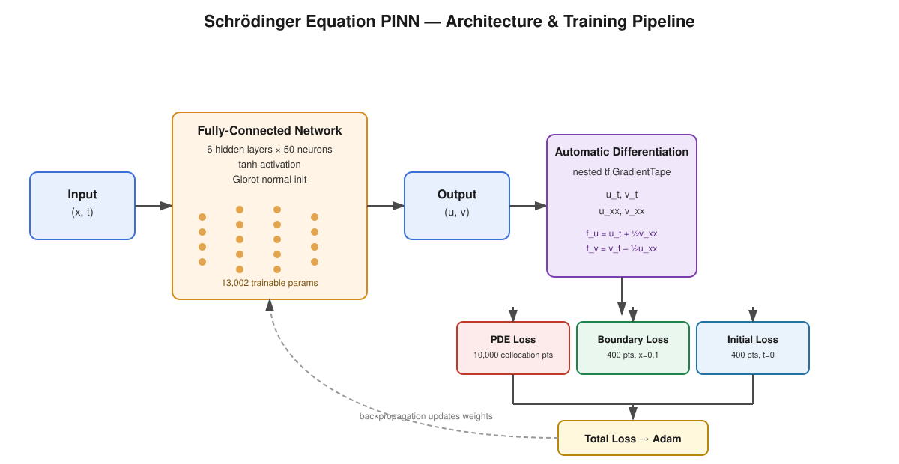
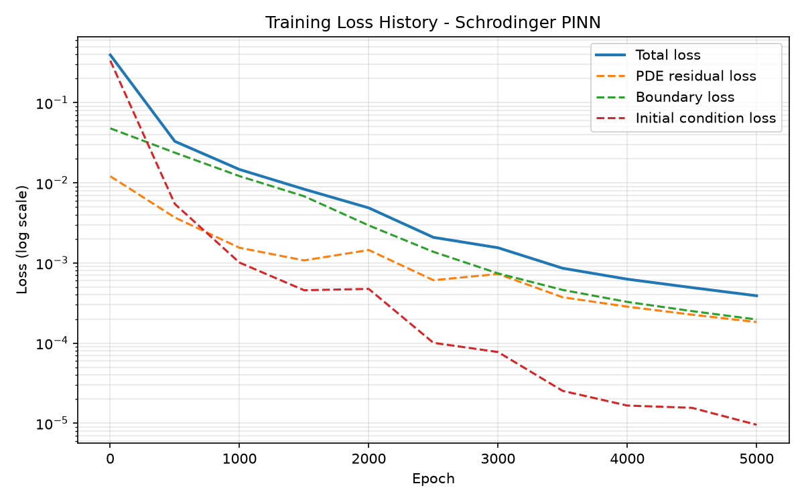
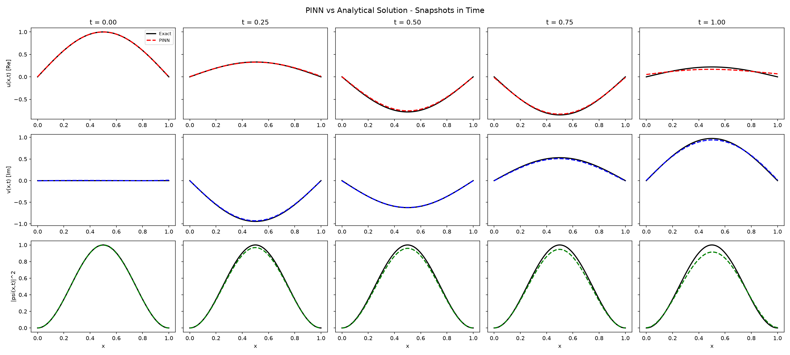
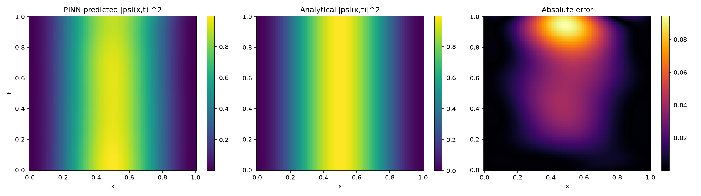

# Physics-Informed Neural Network for the Schrödinger Equation

A TensorFlow Physics-Informed Neural Network (PINN) that solves the 1D
time-dependent Schrödinger equation for a particle in an infinite square
well, and validates the learned wavefunction against the exact analytical
solution.



## Overview

The network learns a complex-valued wavefunction $\psi(x,t)$ that satisfies
the Schrödinger equation, a fixed boundary condition, and a given initial
condition — without ever being shown the analytical solution during
training. Physics is enforced entirely through the loss function via
automatic differentiation, not through labeled solution data.

## The Physics

The time-dependent Schrödinger equation for a particle of mass $m$ in a
potential $V(x)$ is:

$$i\hbar \frac{\partial \psi}{\partial t} = -\frac{\hbar^2}{2m}\frac{\partial^2 \psi}{\partial x^2} + V(x)\psi$$

Working in natural units ($\hbar = m = 1$), the **infinite square well**
(particle in a box) on $x \in [0,1]$ has:

$$V(x) = \begin{cases} 0 & 0 < x < 1 \\ \infty & \text{otherwise} \end{cases}$$

with boundary and initial conditions:

$$\psi(0,t) = \psi(1,t) = 0, \qquad \psi(x,0) = \sin(\pi x)$$

The initial condition is exactly the ground-state eigenfunction, so the
system has a known closed-form solution for all $t$:

$$\psi(x,t) = \sin(\pi x)\, e^{-i\pi^2 t / 2}$$

This exact solution is used **only for validation** — the network never
sees it during training.

## Handling a Complex-Valued Output

Neural networks output real numbers, but $\psi$ is complex. The wavefunction
is split into real and imaginary parts:

$$\psi(x,t) = u(x,t) + i\,v(x,t)$$

and a single network produces **both** $u$ and $v$ simultaneously from
inputs $(x,t)$.

Substituting into the Schrödinger equation (with $V=0$ inside the well) and
separating real/imaginary components gives two coupled, real-valued PDE
residuals the network must drive to zero:

$$f_u := \frac{\partial u}{\partial t} + \frac{1}{2}\frac{\partial^2 v}{\partial x^2} = 0$$

$$f_v := \frac{\partial v}{\partial t} - \frac{1}{2}\frac{\partial^2 u}{\partial x^2} = 0$$

These derivatives are computed exactly via automatic differentiation, using
nested `tf.GradientTape` — an outer tape for the second spatial derivative,
an inner tape for the first-order derivatives in $x$ and $t$.

## Loss Function

The total loss combines three MSE terms, each over a different set of
sampled points:

$$\mathcal{L} = \mathcal{L}_{\text{PDE}} + \mathcal{L}_{\text{BC}} + \mathcal{L}_{\text{IC}}$$

$$\mathcal{L}_{\text{PDE}} = \frac{1}{N_f}\sum_{i=1}^{N_f}\left(f_u^2 + f_v^2\right)_i \qquad \text{10,000 interior collocation points}$$

$$\mathcal{L}_{\text{BC}} = \frac{1}{N_b}\sum_{i=1}^{N_b}\left(u_i^2 + v_i^2\right) \qquad \text{400 boundary points, } x=0,1$$

$$\mathcal{L}_{\text{IC}} = \frac{1}{N_0}\sum_{i=1}^{N_0}\left[(u_i - \sin(\pi x_i))^2 + v_i^2\right] \qquad \text{400 points at } t=0$$

All point sets are sampled using **Latin Hypercube Sampling**
(`scipy.stats.qmc`) for better space-filling coverage than plain uniform
random sampling.

## Network Architecture

| Component | Value |
|---|---|
| Input | $(x, t)$ — 2 features |
| Hidden layers | 6 layers × 50 neurons |
| Activation | tanh (smooth, supports 2nd-order autodiff) |
| Weight init | Glorot normal |
| Output | $(u, v)$ — 2 features, linear |
| Trainable parameters | 13,002 |

## Training

- Optimizer: Adam, learning rate $10^{-3}$
- Full-batch gradient descent, 5000 epochs
- Equal loss weights ($w_{\text{PDE}} = w_{\text{BC}} = w_{\text{IC}} = 1$)
- Per-epoch loss components logged to a Pandas DataFrame, exported as CSV

### Loss Curves



| Metric | Value |
|---|---|
| Initial total loss | 0.9615 |
| Final total loss (epoch 5000) | 3.807 × 10⁻⁴ |
| Loss reduction | ~2526× |

## Validation Against the Analytical Solution

Since the initial condition is the exact ground state, the true probability
density $\lvert\psi(x,t)\rvert^2 = \sin^2(\pi x)$ is **time-independent** —
the system is a stationary state. This gives a strong, visually intuitive
check: the trained network's predicted probability density should stay
essentially flat across all $t$, matching the exact solution.

### Snapshots at Fixed Times



*Real part $u$, imaginary part $v$, and probability density $\lvert\psi\rvert^2$ at $t = 0, 0.25, 0.5, 0.75, 1.0$ — solid black is the exact solution, dashed colored line is the PINN prediction.*

### Full Domain Comparison



*Left: PINN-predicted $\lvert\psi(x,t)\rvert^2$. Middle: exact solution. Right: absolute error. The near-uniform vertical stripes confirm the network correctly learned that this state does not evolve in probability density over time.*

### Quantitative Results

| Metric | Value |
|---|---|
| Relative $L^2$ error on $\psi$ | 3.73% |
| Relative $L^2$ error on $\lvert\psi\rvert^2$ | 5.62% |
| Max absolute error, $u$ | 7.02 × 10⁻² |
| Max absolute error, $v$ | 5.51 × 10⁻² |

## Project Structure

```
pinn-schrodinger/
├── src/
│   ├── __init__.py
│   ├── model.py         # TensorFlow network architecture
│   ├── data.py          # LHS training point generation (Pandas + scipy.qmc)
│   ├── losses.py        # Complex PDE residual, boundary, initial losses
│   ├── train.py         # Training loop (Adam + GradientTape)
│   └── visualize.py     # Validation plots against analytical solution
├── assets/
│   └── architecture_diagram.svg
├── outputs/              # Saved CSVs, plots, trained weights
├── main.py               # Full pipeline entry point
└── requirements.txt      # Dependencies
```

## Running

```bash
python -m venv venv
venv\Scripts\activate        # Windows
pip install -r requirements.txt

python -m src.data            # generate & save training points
python -m src.model            # verify network architecture
python -m src.losses            # verify loss functions & gradient flow
python -m src.train              # train the PINN (~5 min on CPU)
python -m src.visualize            # generate validation plots & metrics
```

Or run the full pipeline in one command:

```bash
python main.py
```

## Stack

Python · TensorFlow · Pandas · NumPy · Matplotlib · SciPy

## Possible Extensions

- **L-BFGS fine-tuning** after Adam — the standard second stage in PINN
  literature, typically tightens the final error by another order of
  magnitude
- **Higher energy eigenstates** ($\psi_n(x,0) = \sin(n\pi x)$) or
  superpositions of eigenstates, which make $\lvert\psi\rvert^2$ genuinely
  time-dependent — a more demanding test of the learned dynamics
- **Non-zero potentials** $V(x)$ — finite well, harmonic oscillator, or
  barrier scattering